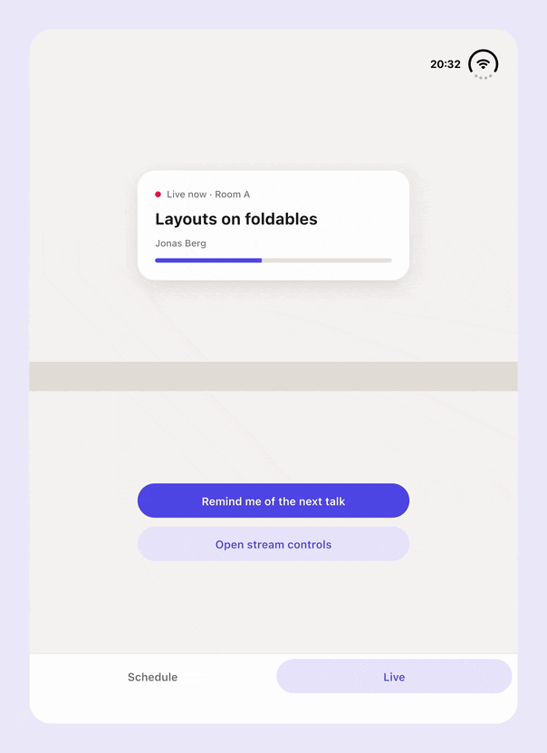

<div align="center">

[![Banner][banner-img]][leancode-landing]

</div>

# duo_kit

[![duo_kit pub.dev badge][pub-badge]][pub-badge-link]

Flutter layouts for iPhone Duo and other foldables.

On iPhone Duo, `FoldScaffold` moves your navigation into the strip at the side
of the window, and `FoldSplitView` puts a list and its details on either side
of the fold when the device opens like a book. duo_kit only places widgets: the
navigation and the panes are your own, in whatever design your app has.

![The example app on iPhone Duo: as the device opens like a book, the list and its details move to either side of the fold, and back when it lies flat][hero-img]

## Why duo_kit

Folding the device changes the window under a running app. duo_kit handles the
parts of that which are easy to miss:

- **State survives folding and unfolding.** Close the device, open it, fold it
  half open: the body of `FoldScaffold` stays the same widget, and the panes of
  `FoldSplitView` carry their state between the split and your own layout.
  Scroll positions and text in fields come through every pose. A pane your
  layout hides can keep its state too, see [Two panes](#two-panes).
- **No double insets.** The navigation gets the padding of where it sits, the
  camera and the status cluster included, so a plain `SafeArea` keeps it
  clear. The body and each pane drop the insets of the edges they do not
  touch, so nothing leaves a gap next to the navigation or the fold.
- **The keyboard stays in its half.** Across a horizontal fold only the pane
  below it makes room for the keyboard; the pane above stays as it is.
- **Dialogs open in the right half.** With `FoldAnchor` an alert opens above a
  horizontal fold and media controls below it. A dialog opened while the
  device lies flat moves to its half once the device folds.
- **Two panes anywhere in the tree.** `FoldSplitView` finds the fold from below
  a top bar or on a page of a `PageView`, and follows it as the page scrolls.
- **Look-alikes are ignored.** A fold at the edge of a window in Split View
  splits nothing, the camera cutout of an Android phone in landscape is not
  taken for a strip, and an occlusion left over from the previous pose is
  dropped.
- **Right-to-left languages.** The first pane and the dialogs move to the
  other side.
- **No iPhone Duo needed.** Switch poses on any device without losing the app
  state, and test against window metrics measured on iPhone Duo.

## Features

- **`FoldBridge`** – on iOS, publishes the fold, the camera and the status
  cluster of iPhone Duo to `MediaQuery`, and reports the hinge.
- **`FoldGeometry`** – the strip, the fold and the occlusions of the window,
  computed from `MediaQuery`.
- **`FoldScaffold`** – puts your navigation along the bottom edge or in the
  strip, also where iOS wants a strip but leaves no room for it, and pads the
  body to match.
- **`FoldSplitView`** – lays two panes out on either side of a fold, with your
  own layout while there is none, and keeps their state when the fold comes and
  goes.
- **`FoldAnchor`** – the `anchorPoint` that opens a dialog or a sheet in the
  right half of a window split by a fold.
- **Development tools** – simulate a fold on any device and see the geometry
  over your app.
- **Test poses** – the window metrics of every iPhone Duo pose, for widget and
  golden tests.

## duo_kit or adaptive_platform_ui

[`adaptive_platform_ui`][adaptive-platform-ui] gives your app the platform's
own widgets: native UIKit toolbars and tab bars with Liquid Glass on iOS 26,
Cupertino on older iOS and Material on Android. On iPhone Duo it lays out its
own toolbar in the strip. Pick it if your app should look like the platform.

duo_kit draws nothing. It lays out the widgets you already have, in your own
design, and handles the rest of the foldable: two panes split at the fold and
dialogs that open in one half. It suits apps with a look of their own, or
Material apps on iOS.

## Installation

```sh
flutter pub add duo_kit
```

duo_kit has iOS code, so an iOS app needs iOS 15.0 or later as its deployment
target, in the Runner target and in its pods.

## Where the geometry comes from

duo_kit reads `MediaQuery.viewPadding` and `MediaQuery.displayFeatures`:

- **Android** – Flutter fills the display features of a foldable by itself.
- **iOS** – Flutter does not fill them yet. `FoldBridge` publishes the fold,
  the camera and the status cluster, the closed device included:

  ```dart
  runApp(const FoldBridge(child: MyApp()));
  ```

  Place it above your app, so that overlays outside the navigator see the fold
  too, and use only one. On other platforms and on devices without a hinge it
  passes its child through.

  With the fold published, Flutter keeps dialogs, sheets and pickers on one side
  of it while the device is half open, as it does on Android.

`FoldBridge` also reports what `MediaQuery` has no room for:

```dart
FoldHinge.maybeOf(context); // The status and the angle of the hinge.
FoldGeometry.of(context).verticalBarEdge; // Where the system wants the strip.
```

Prefer the status of the hinge to its angle: the system decides how often and
how precisely it updates the angle. The edge of the vertical bar is reported
even where the window has no strip, as on the left of Split View.

### How `FoldBridge` works

It reads the reserved regions of the Flutter view, the hinge through
`UIHingeInteraction` and the edge of the vertical bar from the trait
collection, and sends them to Dart each time one of them changes. UIKit sends
no notification when a reserved region changes, so the bridge reads the regions
in the layout of a view that draws nothing, which UIKit lays out again when
they change, as the [`foldable`][foldable] package found.

The fold follows the status of the hinge, since the active flag of its region
turns on about a second after the device comes to rest half open.

## iPhone Duo setup

- **Build with the iOS 27.1 SDK** (Xcode 27.1). With an older SDK, iOS runs the
  app in compatibility mode, with no strip and no reserved regions, and
  `FoldBridge` compiles to nothing.
- **Adopt the UIScene life cycle.** With the iOS 27 SDK an app without it
  crashes at launch. Projects created with Flutter 3.41 already have it; in an
  older one, make your `AppDelegate` a `FlutterImplicitEngineDelegate`,
  register plugins in `didInitializeImplicitFlutterEngine`, and add a
  `UIApplicationSceneManifest` with `FlutterSceneDelegate` to `Info.plist`.
- **Target iOS 15.0 or later**, in the Runner target and in your pods. Xcode 27
  rejects lower deployment targets, and the Flutter 3.41 template still sets
  13.0.
- **Do not lock the orientation.** With `UIRequiresFullScreen` and portrait as
  the only orientation in `Info.plist`, iOS scales the app into a portrait
  window and reports no reserved regions, so no fold. On the simulator the
  missing regions stay with the bundle ID after the lock is gone, until the
  simulator reboots. A lock set with `SystemChrome.setPreferredOrientations`
  keeps the fold but turns the UI on its side on the open device.

## Usage

### Navigation

```dart
FoldScaffold(
  body: SafeArea(bottom: false, child: page),
  navigationBuilder: (context, placement) => MyNavigationBar(
    // Lay the items out along placement.axis: a row at the bottom, a column
    // in the strip.
    axis: placement.axis,
  ),
)
```

The navigation gets the `MediaQuery` padding of where it sits – the bottom
inset, or in the strip the room taken by the camera and the status cluster – so
a `SafeArea` inside it keeps it clear. The body stays the same widget in every
pose and keeps its state.

![The navigation in the strip of the cover display, below the status cluster, and along the bottom edge of the inner display in portrait][navigation-img]

In a strip, `placement` is `left` or `right`, the side the strip runs along. On
iPhone Duo it is `left` on the cover display in landscape with the camera on the
left, and on the left of Split View. Put whatever faces the content, such as a
divider or a selection indicator, on the edge towards the body.

On the left of Split View iOS wants its vertical bar on the left but leaves a
Flutter app no room for it, so `FoldScaffold` takes `verticalBarWidth` there,
84 points by default like the strip on the right. Pass `null` to keep the
navigation at the bottom.

### Two panes

```dart
FoldSplitView(
  first: list,
  second: details,
  unfoldedBuilder: (context, first, second) => Row(
    children: [
      SizedBox(width: 320, child: first),
      Expanded(child: second),
    ],
  ),
)
```

While a fold crosses it, `FoldSplitView` puts `first` on the leading side of a
vertical fold or above a horizontal one, and `second` on the other side. Each
pane keeps only the padding and the view insets, such as the keyboard, of the
edges it touches. Without a fold it uses your layout; put each pane in it once.
Decide when two panes fit with your own breakpoint.

A pane your layout leaves out loses its state. To keep it, hide it instead:

```dart
unfoldedBuilder: (context, first, second) => Stack(
  fit: StackFit.expand,
  children: [
    first,
    Offstage(child: TickerMode(enabled: false, child: second)),
  ],
),
```

### Dialogs and sheets

```dart
showDialog(
  context: context,
  anchorPoint: FoldAnchor.content.resolvePoint(context),
  builder: (context) => const MyDialog(),
);
```

`FoldAnchor.content` opens above a horizontal fold, `FoldAnchor.controls` below
it; across a vertical fold both open on the trailing side. Overlays that are not
routes can do the same with `DisplayFeatureSubScreen`.



### Geometry

```dart
final geometry = FoldGeometry.of(context);

geometry.strip; // The strip at the side, with the clearances of its occlusions.
geometry.division; // The fold that splits the window, if any.
geometry.occlusions; // Cameras and the status cluster.
geometry.availableWidth; // The width without the side insets.
```

![The geometry of four iPhone Duo poses, painted over the example app][geometry-img]

The cover display and the inner display lying flat, then half open like a book
and like a laptop, as `FoldGeometryOverlay` paints them: the strip in blue, the
camera and the status cluster in orange, and the fold in red.

### Development tools

```dart
import 'package:duo_kit/debug.dart';

kDebugMode ? FoldDebugTools(child: app) : app
```

A button at the left edge switches between poses – a strip, a fold like a book,
a fold like a laptop – on any device, and holding it shows or hides the geometry
over your app. Place it below `FoldBridge`.

### Tests

```dart
import 'package:duo_kit/testing.dart';

MediaQuery(data: FoldTestPose.duoHalfOpenedLandscape.data, child: screen)
```

`FoldBridgeScope` stands in for what `FoldBridge` reports, such as the edge of
the vertical bar on the left of Split View:

```dart
FoldBridgeScope(
  verticalBarEdge: FoldVerticalBarEdge.leading,
  child: MediaQuery(
    data: FoldTestPose.duoInnerSplitViewLeft.data,
    child: screen,
  ),
)
```

## Limitations

- A strip is looked for on iOS only, since an Android phone in landscape can
  report the same insets for its camera cutout. Pass `detectStrip` to change
  that.
- Apple's [guidelines for iPhone Duo][hig-duo] put the strip on the left for
  the app on the left of Split View, but iOS 27.1 reserves no room for it in a
  Flutter app. `FoldScaffold` makes the room itself, while
  `FoldGeometry.strip` stays null there. Right-to-left layouts are untested.
- `FoldSplitView` measures where it sits after it builds, resizes or scrolls,
  and catches up one frame later.
- While the device rotates, folds or unfolds, the reserved regions can lead the
  size of the window by a frame or two.
- Tested on the iPhone Duo simulator with iOS 27.1. Android foldables follow
  from the same display features, but have not been tested on a device.

## Working on duo_kit

The repository is a pub workspace of the package and its example, with the
Flutter version pinned by FVM:

```sh
fvm flutter pub get
fvm flutter test
```

---

## 🛠️ Maintained by LeanCode

<div align="center">

  [][leancode-landing]

</div>

This package is built with 💙 by **[LeanCode][leancode-landing]**.
We are **top-tier experts** focused on Flutter Enterprise solutions.

### Why LeanCode?

- **Creators of [Patrol][patrol-landing]** – the next-gen testing framework for Flutter.
- **Full-Cycle Product Development** – We take your product from scratch to long-term maintenance.

<div align="center">
  <br />

  **Need help with your Flutter project?**

  [**👉 Hire our team**][leancode-estimate]
  &nbsp;&nbsp;•&nbsp;&nbsp;
  [Check our other packages][leancode-packages]

</div>

[pub-badge]: https://img.shields.io/pub/v/duo_kit
[pub-badge-link]: https://pub.dev/packages/duo_kit
[banner-img]: https://raw.githubusercontent.com/leancodepl/duo_kit/refs/heads/main/doc/imgs/banner.png
[hero-img]: https://raw.githubusercontent.com/leancodepl/duo_kit/refs/heads/main/doc/imgs/hero.gif
[navigation-img]: https://raw.githubusercontent.com/leancodepl/duo_kit/refs/heads/main/doc/imgs/navigation.png
[geometry-img]: https://raw.githubusercontent.com/leancodepl/duo_kit/refs/heads/main/doc/imgs/geometry.png
[foldable]: https://pub.dev/packages/foldable
[hig-duo]: https://developer.apple.com/design/human-interface-guidelines/designing-for-iphone-duo
[adaptive-platform-ui]: https://pub.dev/packages/adaptive_platform_ui
[leancode-landing]: https://leancode.co/?utm_source=github.com&utm_medium=referral&utm_campaign=duo-kit
[leancode-estimate]: https://leancode.co/get-estimate?utm_source=github.com&utm_medium=referral&utm_campaign=duo-kit
[leancode-packages]: https://pub.dev/packages?q=publisher%3Aleancode.co&sort=downloads
[patrol-landing]: https://patrol.leancode.co/?utm_source=github.com&utm_medium=referral&utm_campaign=duo-kit
